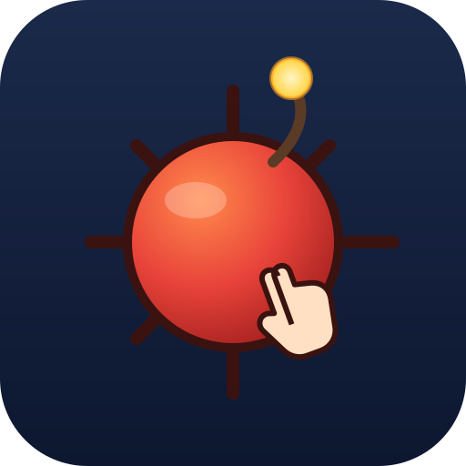

# MineHunt

[](https://github.com/jbautistamartin/MineHunt/releases/latest)
[](LICENSE)
[](https://paypal.me/jbautistamartin)

**Buscaminas invertido.** El objetivo no es esquivar las minas: es encontrarlas
antes que el rival. Un clic destapa o bien una mina, que se anota en tu
marcador, o bien un número con las minas que tiene alrededor. Gana quien más
minas encuentre.

<p align="center">
  
</p>

Es un juego **multijugador por turnos** de 2 a 4 jugadores, humanos o bots, con
cuatro modos de juego, dos idiomas y app de Android. El código es un monorepo de
TypeScript donde cliente y servidor comparten **el mismo motor de juego**.

**Versión actual: [v1.0.1](https://github.com/jbautistamartin/MineHunt/releases/tag/v1.0.1)**,
la primera versión completa — descarga el APK firmado desde la
[página de releases](https://github.com/jbautistamartin/MineHunt/releases). No está
en Google Play todavía. Lo que cambie en cada versión está en
[`CHANGELOG.md`](CHANGELOG.md), y también se puede compilar desde el código, como
cuenta [Cómo se arranca](#cómo-se-arranca).

## Las reglas, en corto

- **Quien encuentra mina sigue jugando.** El turno solo pasa al siguiente cuando
  el clic *no* da mina, así que una racha se premia encadenando clics.
- **Se puede perder el turno por tiempo**, si la partida lleva reloj.
- **No hay cascada automática.** Un clic normal destapa una sola celda. Lo único
  que despeja en cascada es la **onda expansiva**: cada jugador tiene una, se
  gasta en el siguiente clic y luego entra en recarga. Sobre una celda vacía
  arrastra todas las vacías conectadas y su borde numerado; sobre una celda
  numerada se pierde. Acertar dónde tirarla es la decisión del jugador.
- **La partida termina al destapar la última mina**, nunca antes por marcador:
  aunque el líder saque una ventaja imposible de remontar, se sigue jugando.
  Para salir antes está **rendirse**, que deja al jugador de espectador y es
  irreversible.
- Al terminar **se destapa el tablero entero** y sale el resumen, con las minas
  y la puntería de cada jugador.

Todo esto se lo cuenta al jugador la pantalla de ayuda, dentro del juego.

## Los cuatro modos

| Modo | Qué es |
|---|---|
| **Entrenamiento** | Partida suelta en un solo aparato: hotseat de hasta cuatro puestos, con los bots que quieras sentar y el nivel de cada uno por separado —se puede enfrentar un nivel 1 contra un nivel 5—, y tablero, minas, reloj y recarga configurables. |
| **Historia** | 50 niveles repartidos en 5 zonas, con la dificultad subiendo por cuatro vías a la vez: tablero, densidad de minas, nivel de los rivales y reloj de turno. Se avanza solo ganando, y el progreso se guarda. |
| **Multijugador Online** | Salas por código, públicas o privadas, contra gente de verdad por internet. El servidor es la autoridad: valida cada clic, y a quien se cae le sustituye un bot hasta que vuelve con su credencial de reconexión. |
| **Multijugador Local** | De dos a cuatro teléfonos Android jugando entre ellos por Nearby Connections: **sin servidor, sin Wi-Fi común y sin internet**. La sala corre dentro del teléfono que abre la partida. Solo aparece en Android, porque son las radios del aparato. |

Los bots tienen **cinco niveles**, del azar puro al razonamiento por
subconjuntos con cálculo de probabilidades, y **solo ven lo que vería un
humano**: reciben el estado visible del tablero y nada más. Hay pruebas que lo
verifican.

## Estado del proyecto

Versión **1.0.1**. El juego se juega entero en las cuatro modalidades, y el
monorepo compila, tipa y pasa sus pruebas.

- **Hecho:** el motor, los cuatro modos, la app de Android con Capacitor, el
  servidor de salas, los textos en español e inglés, el sonido sintetizado, la
  vibración, las animaciones y el empaquetado del servidor en una imagen Docker
  con el cliente web dentro, endurecida y con prueba de humo.
- **Pendiente:** levantar el servidor en un alojamiento de verdad, con su
  dominio y su HTTPS —la capa de proxy está escrita y ensayada en local—, y
  publicar en Google Play.

El diseño va por fases, y la fuente de verdad es
[`documentos/MineHunt-plan-maestro.md`](documentos/MineHunt-plan-maestro.md),
cuyo apéndice recoge las decisiones tomadas sobre la marcha y manda sobre el
cuerpo del documento.

## Cómo se arranca

Hace falta **Node 24** (el mínimo declarado es 20.19) y npm con workspaces.

```bash
npm install
npm run verificar                                  # compilar + tipos + pruebas
npm run arrancar --workspace @minehunt/web         # el juego en localhost:4200
```

Para el Multijugador Online hacen falta las dos piezas a la vez, el servidor en
el 3000 y la web en el 4200:

```bash
npm run arrancar:dev --workspace @minehunt/server  # y en otra consola, la web
```

En **Windows** hay un `.cmd` por cada tipo de ejecución, para lanzarlos con
doble clic desde el Explorador sin abrir una consola; cada uno lleva su
documentación dentro: `arrancar-web.cmd`, `arrancar-servidor.cmd`,
`arrancar-online.cmd`, `verificar.cmd`, `compilar.cmd`, `verificar-tipos.cmd`,
`probar.cmd`, `probar-motor.cmd`, `probar-web.cmd`, `probar-servidor.cmd`,
`limpiar.cmd`, `android-apk.cmd`, `android-abrir.cmd`, `docker-arrancar.cmd` y
`docker-humo.cmd`.

### Comandos

Desde la raíz, los scripts recorren los tres workspaces:

| Comando | Qué hace |
|---|---|
| `npm run verificar` | Compilar, comprobar tipos y pasar las pruebas, todo seguido. Es la comprobación de siempre. |
| `npm run compilar` | `tsc --build` del motor, `nest build` del servidor y `ng build` de la web. |
| `npm run probar` | Vitest en los tres paquetes (recompila el motor antes, a propósito). |
| `npm run verificar-tipos` | `tsc --noEmit` en los tres. |

Para un paquete suelto, `--workspace @minehunt/<nombre>` (`game-engine`, `web`
o `server`). `probar:ver` deja las pruebas en modo watch, y el servidor tiene
además `probar:e2e`, que levanta la aplicación y juega partidas completas con
clientes de Socket.IO de verdad.

> **Trampa del monorepo:** la web y el servidor consumen el `dist/` compilado
> del motor, no su código fuente. Si tocas el motor y lanzas las pruebas de un
> workspace suelto sin recompilarlo, se prueba contra la versión anterior y los
> errores no tienen ningún sentido.

### Android

El APK es **la misma web** dentro de un WebView; no hay una segunda
implementación de nada. Hace falta el **JDK 21** —ni el 25, que Gradle no admite
todavía— y la plataforma 36 del SDK.

```bash
npm run apk-android --workspace @minehunt/web   # ng build + cap sync + assembleDebug
```

Todo el detalle, con la firma del release y el AAB, en
[`documentos/MineHunt-android.md`](documentos/MineHunt-android.md).

### El servidor, como en producción

La imagen Docker lleva las dos cosas, servidor y cliente web, servidas por el
propio Nest: el juego en `/` y el panel de salas en `/panel`.

```bash
docker compose up -d --build
npm run humo --workspace @minehunt/server -- http://localhost:3000
```

Esa prueba de humo juega una partida entera contra el servidor levantado, que es
lo único que dice de verdad si está sano. Las variables de entorno, el
endurecimiento y la capa de HTTPS con Caddy, en
[`documentos/MineHunt-despliegue.md`](documentos/MineHunt-despliegue.md).

## El monorepo

| Paquete | Qué es |
|---|---|
| [`packages/game-engine`](packages/game-engine) | **El motor**, una librería TypeScript pura: sin Angular, sin DOM y sin nada del navegador. Tablero, turnos, marcador, onda expansiva, reloj, los cinco niveles de IA, la tabla de los 50 niveles del Modo Historia y, en `src/red/`, lo que comparte el multijugador: el protocolo, la sala y el anfitrión de una sola sala. |
| [`apps/web`](apps/web) | **El cliente**, Angular 22 con componentes standalone, señales y carga diferida por pantalla. Es la web, la aplicación instalable y —con Capacitor 8— la app de Android, cuyo proyecto nativo vive en `apps/web/android/`. |
| [`apps/server`](apps/server) | **El servidor**, NestJS 12 con Socket.IO: salas, lobby, reconexión, bots sustitutos y un panel de salas para quien lo administra. |

La decisión estructural es que **el motor es una sola implementación compartida
entre cliente y servidor**. La lógica de juego nueva va ahí, nunca en un
componente de Angular ni en una pasarela de Nest: esos dos orquestan y
presentan. Y el servidor es la autoridad — los clientes mandan intenciones y
reciben el estado que el motor deja ver a cualquiera, así que nadie juega fuera
de su turno ni ve una mina antes de tiempo.

## Convenciones

Son pocas y no se negocian:

1. **Todo el código en español**: variables, funciones, clases y comentarios.
   Solo se respetan los nombres de fichero que imponen Angular y Nest.
2. **Ningún texto visible escrito en el código.** Todo texto de interfaz es una
   clave de i18n y vive en `es.json` y `en.json`, que se tocan los dos en el
   mismo cambio.
3. **El servidor no envía texto traducido**, sino códigos de suceso y datos
   crudos. El cliente compone el texto, así que dos jugadores de la misma
   partida pueden verla cada uno en su idioma.
4. **La IA solo ve lo que vería un humano**, con pruebas que lo verifican.
5. **TypeScript estricto** en los tres paquetes.
6. Los ficheros de prueba usan el sufijo **`.prueba.ts`** (`.e2e-prueba.ts` para
   los e2e), no `.spec.ts`.

## Documentación

Toda la documentación vive en **[`documentos/`](documentos/README.md)**, con su
índice. Lo más usado:

- [**El mapa del repositorio**](documentos/MineHunt-proyectos.md) — qué es cada
  paquete, qué contiene y de qué depende. Por aquí se empieza.
- [**El plan maestro**](documentos/MineHunt-plan-maestro.md) — el diseño, las
  fases y el alcance de cada una.
- [**El cliente**](documentos/MineHunt-web.md) ·
  [**Android**](documentos/MineHunt-android.md) ·
  [**El servidor**](documentos/MineHunt-servidor.md) ·
  [**El multijugador local**](documentos/MineHunt-local.md) ·
  [**El despliegue**](documentos/MineHunt-despliegue.md)

`CLAUDE.md`, en la raíz, es la guía de trabajo del repositorio: el estado
actual, los comandos y el por qué de las decisiones que no se ven en el código.

## Apoyar el juego

MineHunt es gratis, sin anuncios y sin compras dentro del juego. Si te lo pasas
bien con él, puedes invitarme a un café:

[](https://paypal.me/jbautistamartin)

El enlace está también dentro del juego, en **Acerca de**, y en ningún otro
sitio: no desbloquea nada, no hay nada que desbloquear y el juego no pide dinero
mientras se juega.

## Autoría y licencia

MineHunt lo publica **Capicua**; lo desarrolla José Luis Bautista.

Copyright © 2026 José Luis Bautista. Este proyecto se distribuye bajo la **GNU
Lesser General Public License v2.1**, la misma que el resto de las aplicaciones
de la casa; el texto completo está en [`LICENSE`](LICENSE).

En corto, y sin que esto sustituya a lo que dice la licencia: el código se puede
usar, estudiar, modificar y redistribuir, y si publicas una versión modificada
de estos ficheros tienes que publicarla con esta misma licencia y dejar claro
qué cambiaste. Enlazar el motor desde un programa tuyo no obliga a abrir ese
programa —es lo que separa a la LGPL de la GPL—, pero sí a decir que lo usa y a
dar a quien lo reciba la forma de reemplazarlo por su propia versión. El juego
se ofrece **sin garantía de ningún tipo**.
